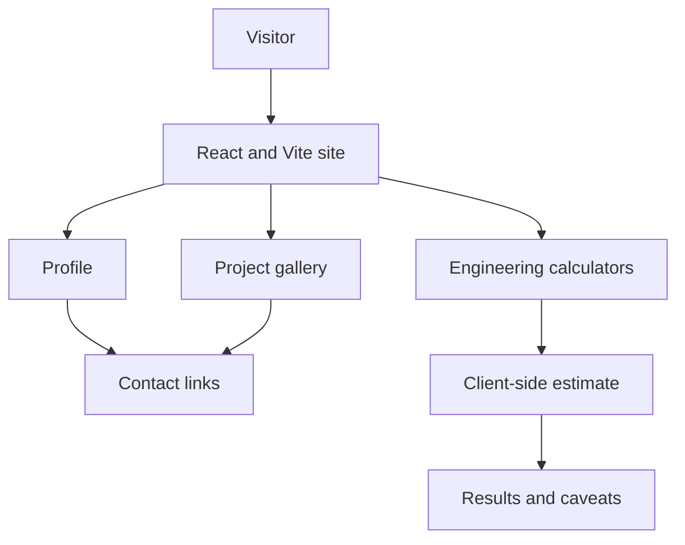

# Nayan Engineering Portfolio — Architecture

## System flow

## Deployment boundary

GitHub Pages supports static frontend assets. Server-side React Router actions, private environment variables, database operations and backend services require a separate application host.

## Engineering notes

Keep configuration separate from source, validate user input, test the production build and verify complete user journeys after deployment.
